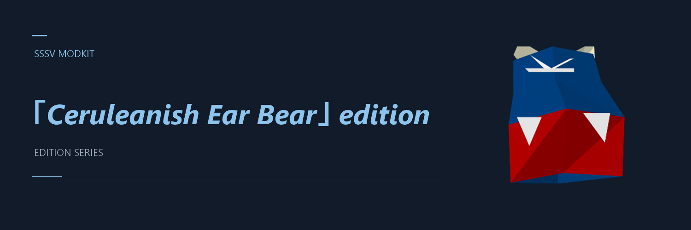
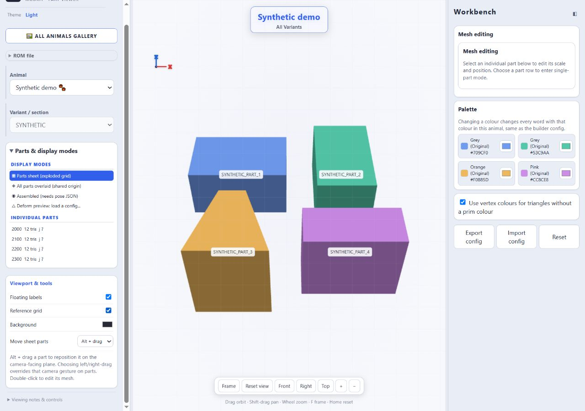
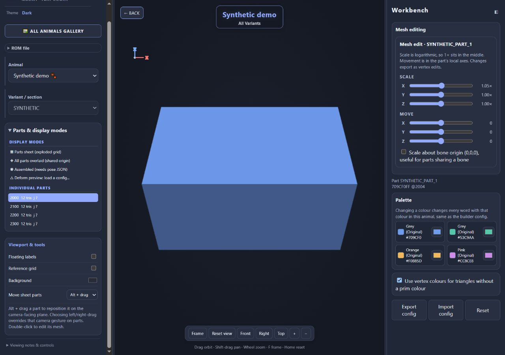

# Space Station Silicon Valley (N64) Modkit



Welcome to the sssv-modkit repository!

**WORK IN PROGRESS**

Changelog and mod blog coming soon.

## FAQs

### What is this?

This is a fan-made modding project for Space Station Silicon Valley on the Nintendo 64.
It lets you change animal colours and reshape their existing body parts, preview
your edits in a browser, and build a patch to play in the game.

There is no finished mod campaign or full game download here yet.

### How do I play this?

To make a local build, you need Python 3.8+, your own US 1.0 `.z64` ROM, and
local animal C source files to generate the animal table. Those files are not
included. Follow the [setup guide](docs/guides/GETTING-STARTED.md) first.

Once setup is done, try the bear edit from the repository root:

```sh
python src/make_animal_mods.py configs/bear.json --out build --name mypack --dry-run
python src/make_animal_mods.py configs/bear.json --out build --name mypack
```

The first command shows what will change. The second creates `build/mypack.ips`
and `build/mypack.z64`. Your original ROM is kept as it is. Open the new ROM in
your N64 emulator to try it; check each build in game.

You can also [open the online Parts Lab](https://sssv-modkit-dev.github.io/sssv-modkit/).
It has three original demo creatures you can try without a ROM. This is a model
viewer and editing demo, not a playable version of Space Station Silicon Valley.
See the [viewer guide](docs/guides/VIEWER.md) for using your own game data locally.

### Is this a decompilation / recompilation?

No.

A decompilation project works backwards from a compiled game to recreate source
code. A recompilation takes code for one system and builds it to run on another,
such as turning an N64 game into a native PC application.

This project edits the original N64 ROM and builds patches. It does not recreate
the whole game's source code or turn the game into a native PC port. LLMs are
used to help reverse engineer how the game stores and uses its data, and to write
the tools for editing it. The current animal-table generator also needs external
animal C source files; it cannot work from a ROM alone.

### Was this made using AI?

Yes.

Most of the code is AI-written or generated, with only minor tweaks such as
renaming file paths done by the developer. Claude and OpenAI coding tools have
been used throughout development.

### Can I play it on my device or phone?

The build tools run on a computer with Python. The local viewer needs a browser
with WebGL. You can try the online demo in your phone's browser, but mobile
controls and compatibility still need testing.

Playing a patched ROM depends on your N64 emulator and device. There is no
standalone phone app or native PC version. Original hardware and every emulator
have not been tested, so support is not guaranteed.

## Features

| Feature | Status |
| --- | --- |
| Change animal colours | Implemented |
| Scale and move existing body parts | Implemented; vertex and triangle counts stay the same |
| Taper, bend, twist and inflate parts | Implemented; a bear deform has been checked in game, but other edits need their own checks |
| Edit individual vertices | Implemented |
| Preview parts and import/export edit configs | Implemented in the browser viewer |
| Try original demo creatures online | Implemented; no ROM needed |
| Build an IPS patch and a patched ROM | Implemented, with ROM/version and conflicting-edit checks |
| Import pose transforms in the viewer | Partial; assembly accuracy needs more checking |
| Import entirely new character models or rigs | Not implemented |
| Shuffle stages | Prototype only; cannot write a playable stage shuffle to the ROM |




These screenshots use original demo geometry. They show the viewer, not an in-game result.

See the [config guide](docs/guides/CONFIGS.md) for available edits and
[project status](docs/PROJECT.md) for unfinished work.
The [separate emulator tools](https://github.com/sssv-modkit-dev/sssv-modkit-automated-testing)
can repeat button presses and take screenshots for testing.

## Credits

Full credits: TBD.

Created and maintained by [sssv-modkit dev](https://github.com/sssv-modkit-dev).
AI tools used: Claude and OpenAI coding tools.

Contact: [sssv-modkit-dev@protonmail.me](mailto:sssv-modkit-dev@protonmail.me).

## License

Original contributions are dedicated under [CC0 1.0 Universal](LICENSE).
Space Station Silicon Valley and third-party material remain the property of
their respective rights holders. No ROMs or extracted game assets are included.
See [NOTICE.md](NOTICE.md) for details.

---

Source code is in [`src/`](src/), example edits in [`configs/`](configs/), and
guides in [`docs/`](docs/README.md). For code checks, see
[development](docs/DEVELOPMENT.md).

<p align="right"><sub>Made by FM</sub></p>
