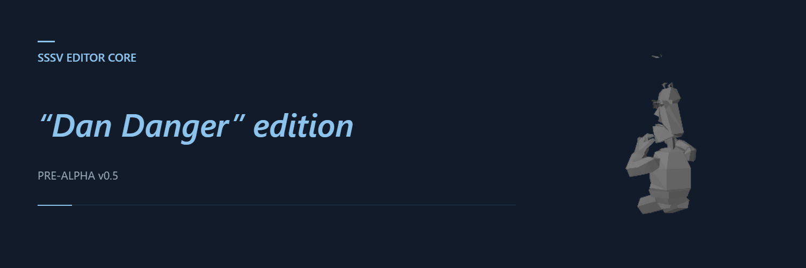

# SSSV Editor



A fan-made editor for *Space Station Silicon Valley* (1998, N64). Level and model editing runs in the browser: open a scene or a model, move and add objects, recolour and reshape parts, then save your edits as a small JSON file you can reopen later. ROM-enabled packs also support browser dialogue and ground texture editing.

**Unofficial fan project. Not affiliated with or endorsed by the rights holders. Ships no game code, ROM or extracted assets. Screenshots and the banner are captures or renders from the game, used only for illustration.**

This repository ships with original sample content only: a generated island scene, three original models and three CC0 models by Quaternius (see [THIRD_PARTY.md](THIRD_PARTY.md)).

## Try it

```sh
python src/build_site.py --pack packs/sample --out build/site
python -m http.server --directory build/site 8000
```

Then open http://localhost:8000/. Nothing is uploaded; files you open are read inside your browser.

In ROM-enabled packs, opening a ROM shares it across the editors using local browser storage. Each page shows its identity; **Forget ROM** removes the shared source and saved edits. Dialogue and painted terrain sheets combine in one browser build. Model and Level edits are also remembered with their source ROM. Controls apply live; Undo reverses an edit or a complete slider gesture. Download your edit files to keep a separate backup.

| Page | What you can do |
|---|---|
| Level Editor | Select, move, rotate and add objects; undo/redo; save and reopen edits (`scene-edits-v1`) |
| Model Editor | Take models apart, recolour, stretch, bend and twist parts; save and reopen edits; share a link |

## Dialogue and Textures & Tilesets

In a ROM-enabled pack, load your ROM in either page. Dialogue lets you choose a message group, edit text and adjust hold times. Watch the space budget and check pacing in game.

Textures & Tilesets lets you select a ground tile, paint pixels and check seams in the repeating preview. Shared tiles can affect several levels. Ground geometry is read-only.

Download edit backups before clearing browser storage. The browser build combines saved dialogue and painted sheets. A pack may also provide a guided build that includes model and level changes. No Python bridge is needed for browser editing.

### Advanced: optional Python bridge

`python tools/story_editor.py` starts the optional developer bridge. It requires separately supplied compatible inputs, Pillow and NumPy. Use the script's `--help` for configuration. Its build includes the selected ground sheet and saved dialogue; check timing and appearance in game.

## How it is built

The editors read a neutral scene format (`scene-v1`) and know nothing about where a scene came from. A **pack** supplies the content and the page copy: `packs/sample/` is the one in this repository. `src/build_site.py --pack <dir>` combines the editors with a pack into a static site. The formats are described in [docs/FORMAT.md](docs/FORMAT.md).

## Background: how game files are usually edited

Some terms you will meet around projects like this:

- **ROM:** a file holding a copy of a cartridge's contents. You supply this file yourself; no ROM is included here.
- **IPS patch:** a small file that lists byte changes to apply to a ROM. People share patches instead of whole files, because a patch contains only their own changes.
- **Decompilation vs recompilation:** decompilation turns a game's machine code back into readable source code that compiles to the same bytes. Recompilation translates the machine code directly into a program for another platform, without first recovering readable source.

## Checks

```sh
python src/check.py
```

It runs the unit tests, a headless browser start-up test, and `tools/guards.py`. The guards check banned words, third-party licences and binary file rules (see `tools/banned-words.txt`).

## Licence

CC0-1.0 ([LICENSE](LICENSE)) for the code and original content. Third-party models keep their own licences, listed in [THIRD_PARTY.md](THIRD_PARTY.md).

**Exception:** the banner (`docs/img/banner-*.png`) is **not** CC0. Its rat head is our render of a character model from the game, which belongs to its rights holders; it is shown for illustration only and is not covered by this project's licence.
