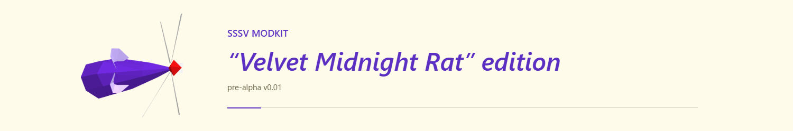

# Space Station Silicon Valley Modkit

<picture>
  <source media="(prefers-color-scheme: dark)" srcset="docs/images/releases/velvet-midnight-rat-dark.png">
  
</picture>

**Explore and edit *Space Station Silicon Valley* (Nintendo 64).** Try the browser editors, or build ROM patches from your own game files with the local tools.

[**Open Model Editor**](https://sssv-modkit-dev.github.io/sssv-modkit/model-editor.html) · [**Open Level Editor**](https://sssv-modkit-dev.github.io/sssv-modkit/level-editor.html) · [**Try Browser Play**](https://sssv-modkit-dev.github.io/sssv-modkit/play.html)

> [!IMPORTANT]
> This is an unofficial fan project, not affiliated with or endorsed by the game's rights holders. **No ROMs or patched ROMs are included.** The tools process files you select locally. Read the [network audit](docs/NETWORK.md) for details about browser requests and third-party runtimes.

## See the Model Editor


*The public Model Editor demo uses original sample geometry. Game-specific editing requires your own supported game files.* See [image notes](docs/images/features/README.md).

## Choose your path

| I want to… | Start here | What I need to know |
| --- | --- | --- |
| Explore demo models | [Model Editor](https://sssv-modkit-dev.github.io/sssv-modkit/model-editor.html) | Bundled demos work without a ROM. |
| Edit a stage | [Level Editor](https://sssv-modkit-dev.github.io/sssv-modkit/level-editor.html) · [Guide](docs/guides/LEVEL-EDITOR.md) | Select your own supported ROM. Terrain is read-only; verify edited builds in game. |
| Play in the browser | [Browser Play](https://sssv-modkit-dev.github.io/sssv-modkit/play.html) | Experimental; compatibility and performance need more testing. Select your own uncompressed ROM or patched build. |
| Build an animal patch | [Getting started](docs/guides/GETTING-STARTED.md) | Requires your own unmodified US 1.0 ROM and Python. |

## Build an animal patch

From the repository root, generate a local animal table from your own US 1.0 ROM. Dry-run the example config and review the report before building:

```sh
python src/animal_table.py --from-rom --out src/animal_table
python src/make_animal_mods.py configs/bear.json --out build --name bear --dry-run
python src/make_animal_mods.py configs/bear.json --out build --name bear
```

The builder writes an IPS patch and, by default, a patched ROM under `build/`. It checks ROM identity and expected bytes, refuses conflicting edits, repairs the header checksum, and verifies the IPS round trip. These safeguards do not establish that a change looks or plays correctly in game. See the [ROM setup](rom/README.md) and [config guide](docs/guides/CONFIGS.md).

## Features and current limits

- **Model Editor:** recolour and reshape existing animal parts, edit vertices, preview changes, and import or export configs. Geometry edits preserve vertex and triangle counts; shading and in-game appearance still need checking.
- **Level Editor:** inspect and edit supported stage objects, save projects, and build ROMs or IPS patches. Terrain editing is not implemented, and arbitrary edits are not guaranteed to work in game.
- **Patch builders:** create animal and level edits locally with source checks and IPS round-trip validation. Animal configs require the US 1.0 ROM; see the [Level Editor guide](docs/guides/LEVEL-EDITOR.md) for level-build constraints.
- **Browser Play and Build & Play:** experimental. Compatibility, controls, and performance need further testing.
- **Not implemented:** importing entirely new character rigs, terrain editing, and a finished combined mod campaign.

For current capabilities, prototypes, and validation status, see [Project status](docs/PROJECT.md).

## Contribute and run checks

Contributions are welcome; see [Contributing](CONTRIBUTING.md) and the [documentation index](docs/README.md). With Python and Node.js installed, run the ROM-free checks from the repository root:

```sh
python src/check.py
```

The checks do not replace browser testing or in-game verification. See [Development](docs/DEVELOPMENT.md) for their scope and limitations.

## Project and license

This project makes **ROM patches**; it is not a decompilation, recompilation, or native PC port. Development has been substantially assisted by AI coding tools; read the [FAQ](docs/FAQ.md) and [development notes](docs/DEVELOPMENT-NOTES.md) for context.

Created and maintained by [sssv-modkit dev](https://github.com/sssv-modkit-dev). Contact: [sssv-modkit-dev@protonmail.me](mailto:sssv-modkit-dev@protonmail.me).

Original contributions are dedicated under [CC0 1.0 Universal](LICENSE). Game imagery and the small, owner-approved set of demo assets remain third-party material and are **not** covered by CC0. See [NOTICE.md](NOTICE.md) for asset, license, and project notices.
