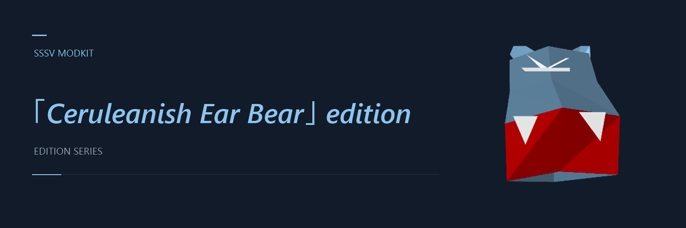

# SSSV Modkit



Recolour and reshape the animals in **Space Station Silicon Valley** for Nintendo 64.
Preview edits in your browser, then build an IPS patch for your own US 1.0 ROM.

The modkit can change colours, scale or move parts, and taper, bend, twist or inflate
existing meshes. Geometry counts stay fixed. It does not yet import new character models.

## Start here

You need **Python 3.8+**, your own **US 1.0 big-endian `.z64` ROM**, and a local
[community decompilation checkout](https://github.com/mkst/sssv) to generate the animal index.
The optional viewer needs a modern browser with WebGL.

1. [Set up your local inputs and generate the animal table](docs/guides/GETTING-STARTED.md).
2. Choose a config from [`configs/`](configs) and review its edits with `--dry-run`.
3. Build the patch, or [open the viewer](docs/guides/VIEWER.md) to explore parts first.

After setup, try the included bear config from the repository root:

```sh
python tools/make_animal_mods.py configs/bear.json --out build --name mypack --dry-run
python tools/make_animal_mods.py configs/bear.json --out build --name mypack
```

The build writes `build/mypack.ips` and `build/mypack.z64`. Your original ROM is
preserved. Use `--no-rom` when you only need the patch.

## Public Parts Lab

[Open the public Parts Lab](https://sssv-modkit-dev.github.io/sssv-modkit/) to explore three original CC0 demo creatures without a ROM.

```text
python tools/build_viewer.py --public
```

Deploy only `site/dist`. Optional game mode reads each visitor's own animal table and ROM locally. See [hosting and privacy details](site/README.md).

## Explore

| I want to… | Go to |
|---|---|
| Create or adjust an animal edit | [Config guide](docs/guides/CONFIGS.md) |
| Inspect parts and preview changes | [Viewer guide](docs/guides/VIEWER.md) |
| Apply a downloaded IPS patch | [Applying patches](docs/guides/GETTING-STARTED.md#apply-a-downloaded-patch) |
| Capture a game scene or run button recipes | [Emulator harness](https://github.com/sssv-modkit-dev/sssv-modkit-automated-testing) |
| Contribute or understand the code | [Development](docs/DEVELOPMENT.md) · [Architecture](docs/ARCHITECTURE.md) |

Browse the [documentation index](docs/README.md) for more, or read the
[project status](PROJECT.md) for current limitations and next steps.

## About

Unofficial fan project. No ROMs or extracted game assets are included. Local tools
and the viewer process your ROM on your machine. See [NOTICE.md](NOTICE.md).

Created and maintained by [sssv-modkit dev](https://github.com/sssv-modkit-dev),
with assistance from Claude and OpenAI coding tools. [Development notes](docs/DEVELOPMENT-NOTES.md).
Contact: [sssv-modkit-dev@protonmail.me](mailto:sssv-modkit-dev@protonmail.me).

Original contributions are dedicated under [CC0 1.0 Universal](LICENSE).
Space Station Silicon Valley and third-party material remain the property of their respective rights holders.

<p align="right"><sub>Made by FM</sub></p>
