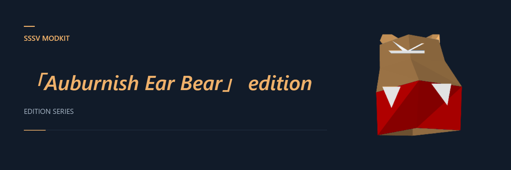
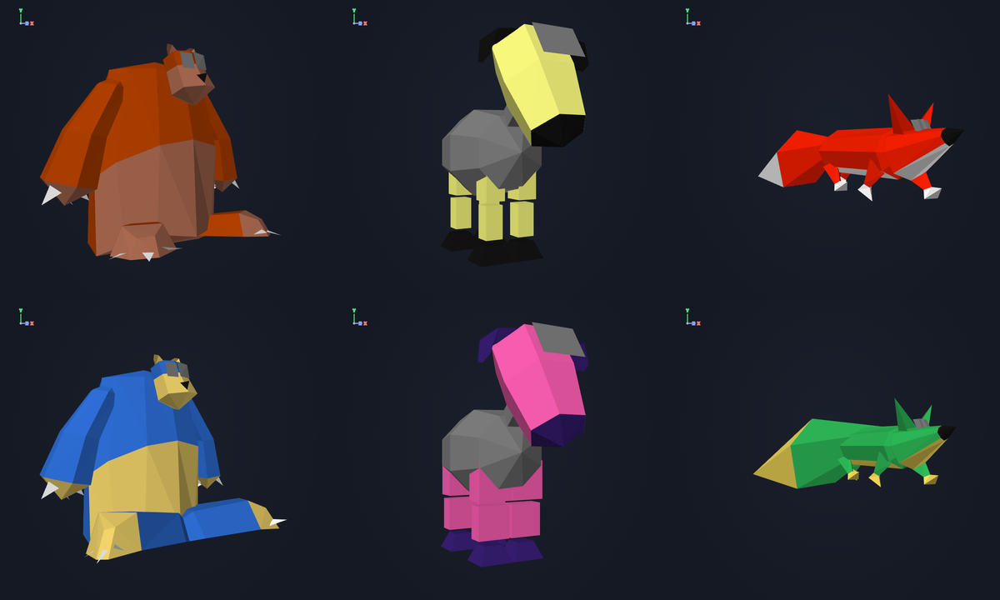

# Space Station Silicon Valley (N64) - Modkit

Work In Progress // _last updated: 2026-11-06_

***Welcome to the Space Station Silicon Valley (sssv) Modkit public repository!***  

* **Quick directory:**
  * Source code [`src/`](src/), example edits in [`configs/`](configs/),
guides in [`docs/`](docs/README.md). For code checks
[development](docs/DEVELOPMENT.md).

## Contents

- [What is this?](#what-is-this)
  - [Is it a **de**compilation / **re**compilation?](#is-this-a-decompilation--recompilation)
  - [Was it made with AI?](#was-this-made-using-ai)
- [How do I play this?](#how-do-i-play-this)
- [Features](#features)
- [Credits](#credits)
- [License](#license)

## FAQs

### What is this?

❓ Answer:

A fan-made modding project for Space Station Silicon Valley (Nintendo 64, orginal release: 1998).

It consists of:
1. 🛠 Tools to modify & recolor the models 
2. 🗺 A level editor 
3. ⚙ Scripts to build your own ROM patch mod for the game.

### How do I play this?

🕹 Answer:

  
| What you want to do | Where | What you need |
| --- | --- | --- |
| Try out the tools | [Edit models: Model Editor demo](https://sssv-modkit-dev.github.io/sssv-modkit/model_editor.html) | Nothing; it opens with five bundled animals and three original demo creatures. |
| Edit levels | [Level Editor demo](https://sssv-modkit-dev.github.io/sssv-modkit/level-editor.html) ([guide](docs/guides/LEVEL-EDITOR.md)) | Your own stock or compatible modded ROM, opened locally. |
| Play in the browser | [Browser play](https://sssv-modkit-dev.github.io/sssv-modkit/play.html) | Your own uncompressed ROM or patched build. Experimental; compatibility and performance are still being tested. |
| Make a local build | [Getting started](docs/guides/GETTING-STARTED.md) | Your own ROM ([details](rom/README.md)); open the patched ROM in your emulator. |

You can try the online demos in your phone's browser, but mobile controls and
compatibility still need testing. The build tools run on a computer with Python,
and the local viewer needs a browser with WebGL. Playing a patched ROM depends on
your N64 emulator and device. There is no standalone phone app or native PC
version, and original hardware and most emulators have not been tested, so
support is not guaranteed.

#### Is this a decompilation / recompilation?

👨‍💻 Answer

No. This project makes **ROM patches**.

| Method | Summary |
| --- | --- |
| Decompilation | Works backwards from a compiled game to recreate its source code. |
| Recompilation | Takes code for one system and builds it to run on another, such as an N64 game as a native PC application. |
| ROM patch (this project) | Edits the original N64 ROM, without recreating the game's source or making a native PC port. |

#### Was this made using AI?

🤖 Answer

Yes.

Most of the code is AI-written or generated, with only minor tweaks such as
renaming file paths done by the developer.

Anthropic and OpenAI coding tools have been used throughout development.
For details, see [AI development details](docs/DEVELOPMENT-NOTES.md):

- [What the AI tools did](docs/DEVELOPMENT-NOTES.md#what-the-ai-tools-did)
- [What the Developer did](docs/DEVELOPMENT-NOTES.md#what-the-developer-did)

### Features

| Feature | Status |
| --- | --- |
| Change animal colours | Implemented |
| Scale and move existing body parts | Implemented; vertex and triangle counts stay the same |
| Taper, bend, twist and inflate parts | Implemented; a bear deform has been checked in game, but other edits need their own checks |
| Edit individual vertices | Implemented |
| Preview parts and import/export edit configs | Implemented in the browser viewer |
| Try bundled and original demo creatures online | Implemented; no ROM needed |
| Build an IPS patch and a patched ROM | Implemented, with ROM/version and conflicting-edit checks |
| Assemble animals from pose transforms | Implemented; the five bundled demo animals ship poses captured from the running game. Imported poses for other animals need their own checks |
| Import entirely new character models or rigs | Not implemented |
| Shuffle stages | Prototype only; cannot write a playable stage shuffle to the ROM |

#### Animal edits

Originals on top, edited below, as previewed in the online Model Editor (no ROM
needed). Each new edit still needs testing in game.

#### In development

This older research capture shows saved camera and display settings. The public
[Level Editor](docs/guides/LEVEL-EDITOR.md) now supports object editing and project files.

Minimap and HUD changes remain research prototypes.

| Feature | Status |
| --- | --- |
| Level viewer | Public local-ROM viewer with textured terrain, props, and rough animal previews |
| Level editing | Public object editor with project files and ROM/IPS builds; edited builds still need their own in-game verification |
| Minimap | In-game prototype checked on Level 1; other levels and patch combinations need testing |
| HUD texture changes | Restyled HUD checked in a patched ROM; public editing controls still needed |
| Play in the browser | Experimental launcher and Build & Play implemented; game compatibility and performance still need testing |

| Minimap prototype | HUD texture prototype |
| --- | --- |
|  |  |

Screenshots show the current prototypes, not a finished mod campaign.
See [image notes](docs/images/features/README.md) for what each capture demonstrates.

See the [config guide](docs/guides/CONFIGS.md) for available edits and
[project status](docs/PROJECT.md) for unfinished work.
The [separate emulator tools](https://github.com/sssv-modkit-dev/sssv-modkit-automated-testing)
can repeat button presses and take screenshots for testing.

### Credits

Full credits: TBD.

Created and maintained by [sssv-modkit dev](https://github.com/sssv-modkit-dev).
AI tools used: Anthropic and OpenAI coding tools, including Claude Code and OpenAI's Codex.

Codex-assisted commits can include a `Co-authored-by` trailer to make tool
attribution visible in the Git history.

Contact: [sssv-modkit-dev@protonmail.me](mailto:sssv-modkit-dev@protonmail.me).

### License

Original contributions are dedicated under [CC0 1.0 Universal](LICENSE).
Space Station Silicon Valley and third-party material remain the property of
their respective rights holders. No ROMs or extracted game assets are included.
See [NOTICE.md](NOTICE.md) for details.

---

Made by FM

