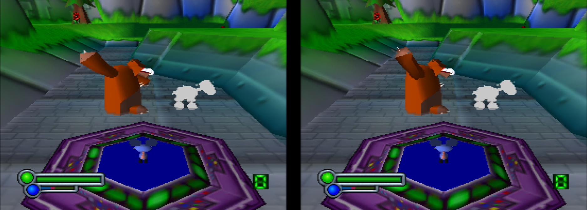
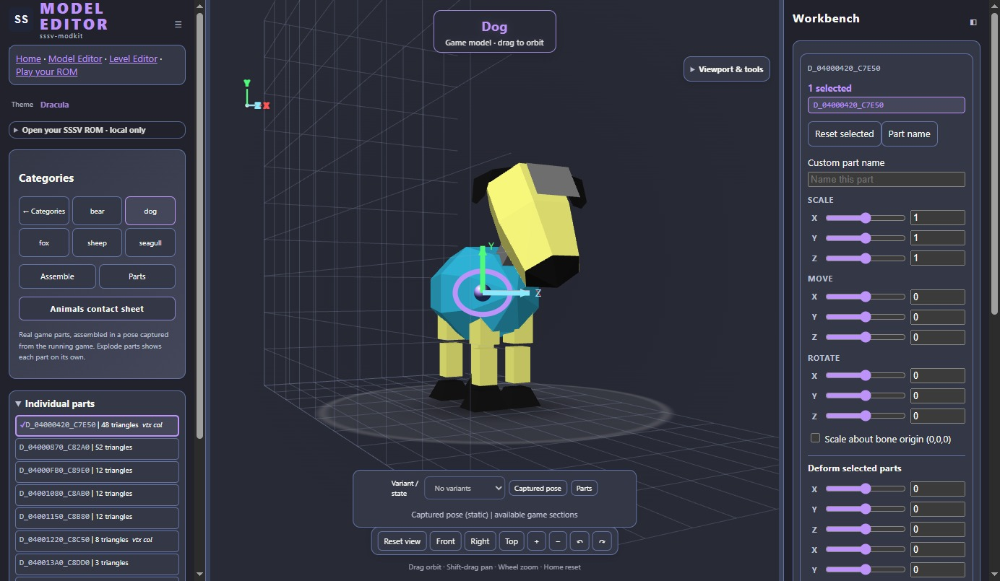
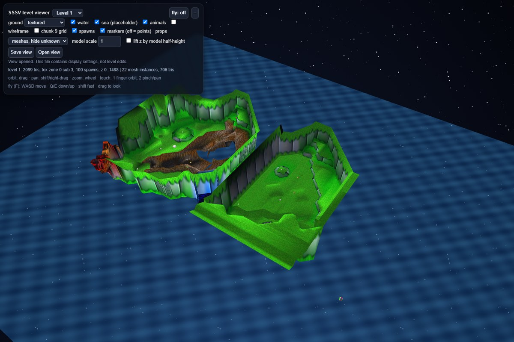
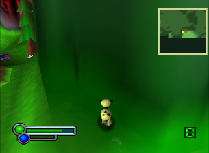
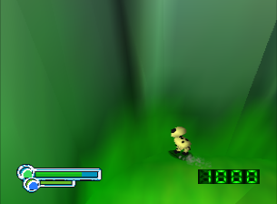

# Space Station Silicon Valley (N64) - Modkit

## Welcome
Welcome to the sssv-modkit public repository!

**WORK IN PROGRESS**

Changelog and mod blog coming soon.

## FAQs

### What is this?

This is a fan-made modding project for Space Station Silicon Valley on the Nintendo 64.
It lets you change animal colours and reshape their existing body parts, preview
your edits in a browser, and build a patch to play in the game.

There is no finished mod campaign (yet) or full game download here (ever).

### How do I play this?

- [Try Parts Lab in your browser](https://sssv-modkit-dev.github.io/sssv-modkit/): change colours and shapes, then save your edits. It opens with three original demo creatures.
- [Edit levels in your browser](https://sssv-modkit-dev.github.io/sssv-modkit/levels.html): open your stock ROM locally, select named objects by category or drag a selection box, then export your edits. [Level editor guide](docs/guides/LEVEL-EDITOR.md).
- [Play your ROM in the browser](https://sssv-modkit-dev.github.io/sssv-modkit/play.html): select your own uncompressed ROM or patched build. Experimental; gameplay compatibility and performance are still being tested.
- [Make a local build](docs/guides/GETTING-STARTED.md): build a patch using your own US 1.0 ROM and the required local animal C source files, then open the patched ROM in your emulator.

### Is this a decompilation / recompilation?

No.

A **decompilation** project works backwards from a compiled game to recreate source
code.

A **recompilation** takes code for one system and builds it to run on another,
such as turning an N64 game into a native PC application.

This project makes **ROM patches**.
It edits the original N64 ROM. It does not recreate
the whole game's source code or turn the game into a native PC port.

LLMs help investigate how the game stores and uses its data, and write the tools
for editing it. Ghidra is used to inspect the compiled game; an MCP connection
lets the coding tools work with that analysis. Findings are checked against ROM
data and emulator behaviour. An AI explanation alone is not proof.

The research lives in a separate private repository. This public repository holds
the modding tools, example edits, and instructions, without the ROM or extracted
game files.

The current animal-table generator also needs external
animal C source files; it cannot work from a ROM alone.

### Was this made using AI?

Yes.

Most of the code is AI-written or generated, with only minor tweaks such as
renaming file paths done by the developer.

Claude and OpenAI coding tools have been used throughout development.

### What did the AI work on vs. what did the mod developer work on?

The AI tools handled most of the code, reverse-engineering work, debugging,
tests, and first drafts of the documentation.

I choose what to build, set the direction, try the results in the viewer and
game, and give feedback on what needs to change. I also make small manual edits
and decide what goes into the public repository. This is a project I direct
with AI tools; I am not presenting the code as mostly hand-written.

### Can I play it on my device or phone?

The build tools run on a computer with Python. The local viewer needs a browser
with WebGL. You can try the online demo in your phone's browser, but mobile
controls and compatibility still need testing.

Playing a patched ROM depends on your N64 emulator and device. There is no
standalone phone app or native PC version. Original hardware and every emulator
have not been tested, so support is not guaranteed.

## Features

| Feature | Status |
| --- | --- |
| Change animal colours | Implemented |
| Scale and move existing body parts | Implemented; vertex and triangle counts stay the same |
| Taper, bend, twist and inflate parts | Implemented; a bear deform has been checked in game, but other edits need their own checks |
| Edit individual vertices | Implemented |
| Preview parts and import/export edit configs | Implemented in the browser viewer |
| Try original demo creatures online | Implemented; no ROM needed |
| Build an IPS patch and a patched ROM | Implemented, with ROM/version and conflicting-edit checks |
| Import pose transforms in the viewer | Partial; assembly accuracy needs more checking |
| Import entirely new character models or rigs | Not implemented |
| Shuffle stages | Prototype only; cannot write a playable stage shuffle to the ROM |

### Animal edits

Original on the left, edited ROM on the right. The bear's arms and shoulders are
tapered and bent. This build was checked in game; each new edit still needs testing.

### Parts Lab

Preview parts, change their colours and shapes, and use **Save edits** to download
a JSON file. **Open edits** loads it again. The online demo starts with original
creatures; you can load your own game files locally.

### In development

The level viewer can save and reopen its camera and display settings. Moving
objects and saving level edits still need an editor UI.

These are research prototypes. They are not included in the public builder yet.

| Feature | Status |
| --- | --- |
| Level viewer | Private prototype with textured terrain, props, and rough animal previews |
| Level editing | Command-line spawn edits can produce a ROM and IPS patch; editor UI and in-game verification of the edited build are still needed |
| Minimap | In-game prototype checked on Level 1; other levels and patch combinations need testing |
| HUD texture changes | Restyled HUD checked in a patched ROM; public editing controls still needed |
| Play in the browser | Planned; emulator integration and game compatibility need testing |

| Minimap prototype | HUD texture prototype |
| --- | --- |
|  |  |

Screenshots show the current prototypes, not a finished mod campaign.
See [image notes](docs/images/features/README.md) for what each capture demonstrates.

See the [config guide](docs/guides/CONFIGS.md) for available edits and
[project status](docs/PROJECT.md) for unfinished work.
The [separate emulator tools](https://github.com/sssv-modkit-dev/sssv-modkit-automated-testing)
can repeat button presses and take screenshots for testing.

## Credits

Full credits: TBD.

Created and maintained by [sssv-modkit dev](https://github.com/sssv-modkit-dev).
AI tools used: Claude and OpenAI coding tools.

Contact: [sssv-modkit-dev@protonmail.me](mailto:sssv-modkit-dev@protonmail.me).

## License

Original contributions are dedicated under [CC0 1.0 Universal](LICENSE).
Space Station Silicon Valley and third-party material remain the property of
their respective rights holders. No ROMs or extracted game assets are included.
See [NOTICE.md](NOTICE.md) for details.

---

Source code is in [`src/`](src/), example edits in [`configs/`](configs/), and
guides in [`docs/`](docs/README.md). For code checks, see
[development](docs/DEVELOPMENT.md).

Made by FM

