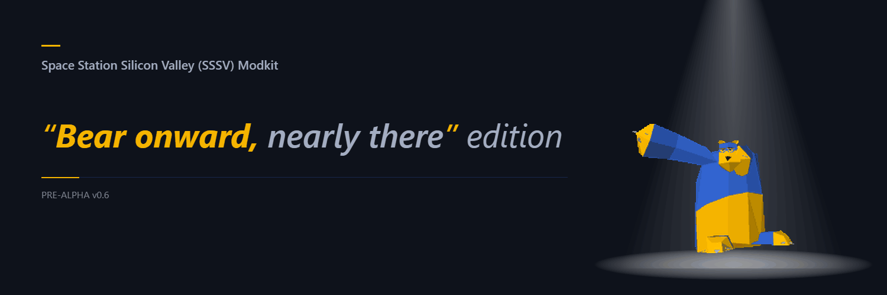

# Space Station Silicon Valley Modkit



**Explore and edit *Space Station Silicon Valley* (Nintendo 64).** Try the browser editors, or build ROM patches from your own game files with the local tools.

[**Open Model Editor**](https://sssv-modkit-dev.github.io/sssv-modkit/model-editor.html) · [**Open Level Editor**](https://sssv-modkit-dev.github.io/sssv-modkit/level-editor.html) · [**Try Browser Play**](https://sssv-modkit-dev.github.io/sssv-modkit/play.html)

> [!IMPORTANT]
> This is an unofficial fan project, not affiliated with or endorsed by the game's rights holders. **No ROMs or patched ROMs are included.** The tools process files you select locally. Read the [network audit](docs/NETWORK.md) for details about browser requests and third-party runtimes.

[**Start a guided build**](https://sssv-modkit-dev.github.io/sssv-modkit/start.html): load your ROM, choose Patch only or Mod in depth, review your changes, then build and play. See the [guided build guide](docs/guides/GUIDED-BUILD.md).

[**Guides: start here**](docs/README.md) — Getting started, Models, Textures & Tilesets, Levels, Dialogue and Play.

## Choose your path

| I want to… | Start here | What I need to know |
| --- | --- | --- |
| Explore sample models | [Model Editor](https://sssv-modkit-dev.github.io/sssv-modkit/model-editor.html) | Bundled samples work without a ROM. |
| Edit a stage | [Level Editor](https://sssv-modkit-dev.github.io/sssv-modkit/level-editor.html) · [Guide](docs/guides/LEVEL-EDITOR.md) | Select your own supported ROM. Edit terrain in Textures & Tilesets; verify edited builds in game. |
| Play in the browser | [Browser Play](https://sssv-modkit-dev.github.io/sssv-modkit/play.html) | Experimental; compatibility and performance need more testing. Select your own uncompressed ROM or patched build. |
| Build a patched ROM | [Guided build](https://sssv-modkit-dev.github.io/sssv-modkit/start.html) · [Guide](docs/guides/GUIDED-BUILD.md) | Runs in your browser with your own US 1.0 ROM; combines model, level, texture, dialogue and Classic+ changes. |
| Use it offline | [Download a bundle](https://github.com/sssv-modkit-dev/sssv-modkit/releases) (Windows, macOS, Linux) | Unzip, put your ROM in `rom/`, run `sssv-modkit`. The same tools in your own browser, served from your computer; builds land in `out/` for any emulator. Not code-signed, so expect a first-run warning. |

## Command line (optional)

The browser guided build covers the same animal, level and texture edits. If you prefer scripts, the Python builders produce byte-identical output; see [Command-line builds](docs/guides/CLI-BUILDS.md) and the [config guide](docs/guides/CONFIGS.md).

## Features and current limits

- **Model Editor:** recolour and reshape existing animal parts, edit vertices, preview changes, and import or export configs. Geometry edits preserve vertex and triangle counts; shading and in-game appearance still need checking.
- **Level Editor:** inspect and edit supported stage objects, save projects, and build ROMs or IPS patches. Edit terrain textures in Textures & Tilesets. Arbitrary edits are not guaranteed to work in game.
- **Patch builders:** create animal and level edits locally with source checks and IPS round-trip validation. Animal configs require the US 1.0 ROM; see the [Level Editor guide](docs/guides/LEVEL-EDITOR.md) for level-build constraints.
- **Browser Play and Build & Play:** experimental. Compatibility, controls, and performance need further testing.
- **Not implemented:** importing entirely new character rigs and a finished combined mod campaign.

For current capabilities, prototypes, and validation status, see [Project status](docs/PROJECT.md).

## Contribute and run checks

Contributions are welcome; see [Contributing](CONTRIBUTING.md) and the [documentation index](docs/README.md). With Python and Node.js installed, run the ROM-free checks from the repository root:

```sh
python src/check.py
```

The checks do not replace browser testing or in-game verification. See [Development](docs/DEVELOPMENT.md) for their scope and limitations.

## Project and license

This project makes **ROM patches**; it is not a decompilation, recompilation, or native PC port. Development has been substantially assisted by AI coding tools; read the [FAQ](docs/FAQ.md) and [development notes](docs/DEVELOPMENT-NOTES.md) for context.

Created and maintained by [sssv-modkit dev](https://github.com/sssv-modkit-dev). Contact: [sssv-modkit-dev@protonmail.me](mailto:sssv-modkit-dev@protonmail.me).

Original contributions are dedicated under [CC0 1.0 Universal](LICENSE). Game imagery and the small, owner-approved set of sample assets remain third-party material and are **not** covered by CC0. See [NOTICE.md](NOTICE.md) for asset, license, and project notices.
