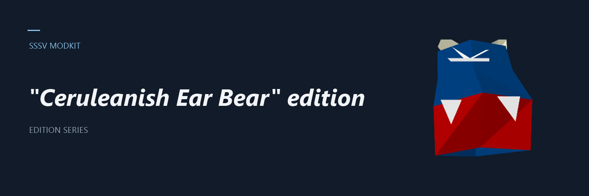

# SSSV Modkit



Tools and patches for modding **Space Station Silicon Valley** (Nintendo 64, US 1.0): recolour the animals,
reshape their meshes, and build small `.ips` patches you can apply to your own ROM.

> Unofficial fan project. **No ROM or extracted models are included.** You must supply your own legally obtained
> US 1.0 ROM. See [NOTICE.md](NOTICE.md).

## What you need

- Python 3.8+ (Windows, macOS or Linux; no extra packages)
- Your own US 1.0 ROM in big-endian `.z64` format, SHA1 `e5e09205aa743a9e5043a42df72adc379c746b0b`
- A modern browser (for the part viewer)

Put the ROM in `rom/` (see [rom/README.md](rom/README.md)). It is git-ignored and never leaves your machine.

## Quick start

First generate the private animal table as described below. Run these commands from the repository root:

```
python tools/make_animal_mods.py configs/bear.json --out build --name mypack --dry-run
python tools/make_animal_mods.py configs/bear.json --out build --name mypack
```

- `--dry-run` lists every edit without writing anything. Always run it first.
- The ROM is found automatically in `rom\` by its SHA1; use `--rom FILE` to point elsewhere.
- Output goes to `build\`: `mypack.ips` (the patch) and `mypack.z64` (patched ROM; skip with `--no-rom`).
- Your original ROM is never modified. Every build re-applies the patch to the original and checks the
  result byte for byte before finishing.

Pass a folder, wildcards (`configs\*.json`), single files, or a combined "pack" file, in any mix.

## Applying a patch you downloaded

Use any IPS patcher (for example Floating IPS) on your own US 1.0 `.z64`. The patch contains only the
changed bytes, and the N64 header checksums are already fixed.

## Configs

One small JSON file per animal (or one combined pack). Example:

```json
{
  "animal": "bear",
  "recolor": { "B03F00FF": "3A2418FF", "AD6B52FF": "D9A441" },
  "mesh": [ { "symbol": "D_04002D90_CA7C0", "scale": [1.2, 1.2, 1.2], "move": [0, 0, 3] } ]
}
```

| Key | What it does |
|---|---|
| `recolor` | old RGBA to new RGB or RGBA, applied to every matching colour in that animal's own display lists |
| `words` | edit individual colour words by ROM address, with the expected old value |
| `skip_words` | colour word addresses to leave alone |
| `mesh` | scale and move all vertices of a part |
| `deform` | taper, bend, twist, or inflate a part without adding geometry |
| `vertices` | exact single-vertex edits, each checked against the value you expect |

Every edit checks what it is about to overwrite and refuses to run if the ROM does not match. Vertex and
triangle counts never change. The full reference is the docstring at the top of
[tools/make_animal_mods.py](tools/make_animal_mods.py).

## The animal table

The builder needs `tools/animal_table.json`, a per-animal index of display lists, colour words and vertex
groups. It is derived from the ROM, so it is **not** shipped in this repository; you generate it locally with
`tools/animal_table.py`, using your own ROM and a local checkout of the community decompilation
(https://github.com/mkst/sssv). Keep that checkout outside this repository. From the repository root,
pass its animal-source directory and the output prefix:

```text
python tools/animal_table.py /path/to/sssv/src.us/sssv/animals tools/animal_table
```

Replace the source path with the location in your checkout. This writes `tools/animal_table.json`
and `tools/animal_table.md`; keep both private. The generator reads the ROM from `rom/`
or the `SSSV_ROM` environment variable.

## Part viewer

To generate the table and viewer in one command (ROM in `rom/` or set via `SSSV_ROM`):

```text
python tools/build_viewer.py --animals-dir /path/to/sssv/src.us/sssv/animals
```

If you already generated the table, rebuild just the viewer:

```text
python tools/build_viewer.py tools/animal_table.json
```

Run `python tools/build_viewer.py --help` for paths and options.

Open the generated `viewers/parts_viewer.html` and load your own ROM to inspect animal parts,
try scale sliders, and preview deformations. The page runs entirely in your browser; nothing
is uploaded. Its embedded animal metadata is derived from local inputs, so keep the generated
page private. Active sources live in `tools/viewer/` (HTML, CSS, and JavaScript).
Left-drag orbits, right-drag pans, and the wheel zooms. Alt + drag moves a sheet
part. Use the camera toolbar or focus the viewport and press `F` to frame,
`Home` to reset, or `1` / `3` / `7` for front / right / top views.
See [viewer controls and screenshots](docs/VIEWER-CONTROLS.md) for the full
reference and a reproducible ROM-free browser fixture.
Deformations preserve geometry counts and leave normals unchanged, so large bends or twists
can affect shading.

### Public Parts Lab

[Open the public Parts Lab](https://sssv-modkit-dev.github.io/sssv-modkit/).

Build a shareable playground with three original CC0 demo creatures and no game data:

```text
python tools/build_viewer.py --public
```

Open `site/dist/index.html`, or deploy only `site/dist` to static hosting. This mode
never reads your local animal table or ROM. Visitors can explore assembled and
exploded models, recolour and deform parts, and share demo presets. Optional game
mode accepts each visitor's own locally generated animal table and ROM.
See [hosting and privacy details](site/README.md). A GitHub Pages workflow is included.

## Repository layout

```
rom/       your ROM goes here (ignored by git; only rom/README.md is tracked)
configs/   one JSON per animal, plus packs
examples/  templates and synthetic logic inputs
tests/     synthetic parity fixtures and checks (Node.js needed for JS checks)
tools/     builder, table generator, viewer builder
viewers/   locally generated browser part viewer (private)
docs/      development documentation
build/     generated patches and ROMs (ignored by git)
```

For development checks, run `python tools/check.py` (Python and Node.js, no packages or ROM needed).
These checks cover source syntax and synthetic behavior; browser rendering and in-game behavior
need separate checks.

## Credits

Created and maintained by [sssv-modkit dev](https://github.com/sssv-modkit-dev),
with assistance from Claude and OpenAI coding tools. See [development notes](docs/DEVELOPMENT-NOTES.md)
for the development workflow.
Contact: [sssv-modkit-dev@protonmail.me](mailto:sssv-modkit-dev@protonmail.me).

- Space Station Silicon Valley belongs to its original developer and publisher.

## License

To the extent possible under law, sssv-modkit dev has waived all copyright and related rights
in their original contributions to this project under [CC0 1.0 Universal](LICENSE).
Attribution is appreciated but not required. This dedication does not cover the original game
or third-party material; applicable third-party terms remain separate. See [NOTICE.md](NOTICE.md).

<p align="right"><sub>Made by FM</sub></p>
