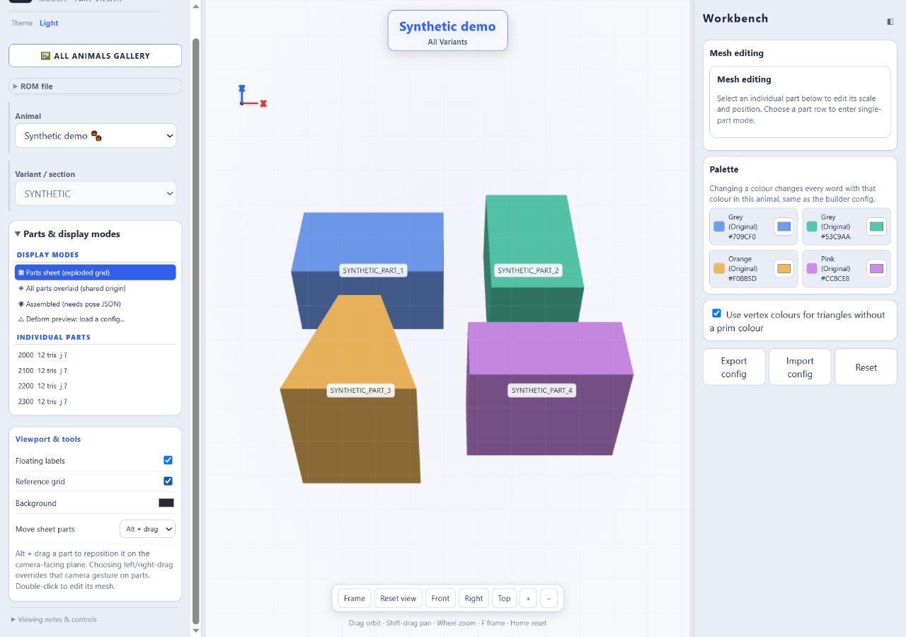
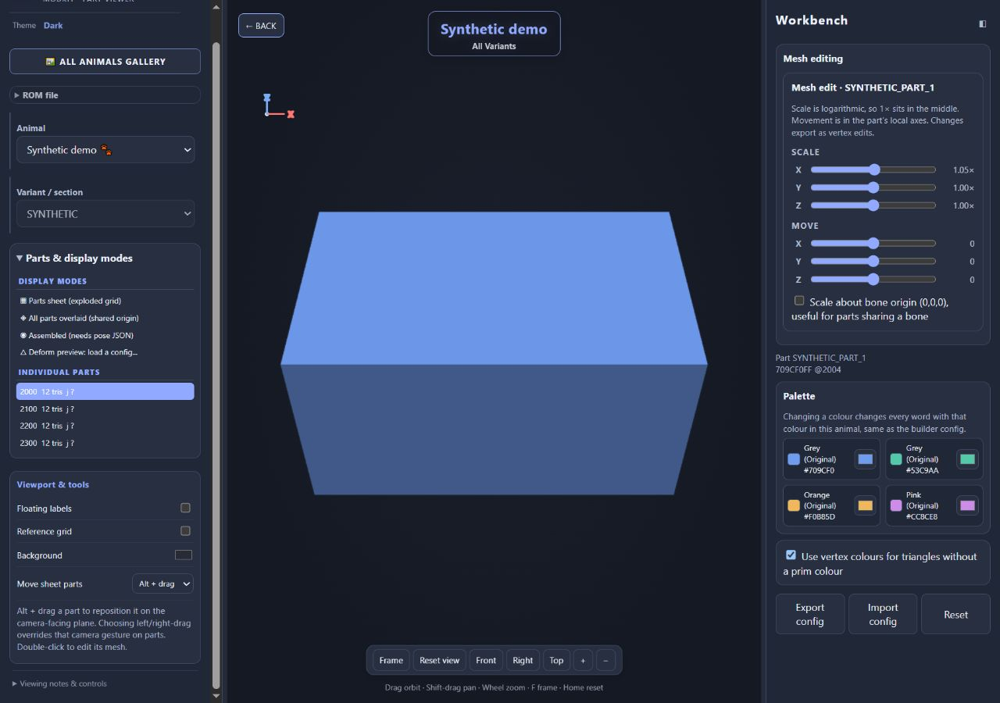

# Viewer controls and browser validation

The camera follows the familiar [OrbitControls mouse convention](https://threejs.org/docs/pages/OrbitControls),
implemented in vanilla JavaScript for the portable WebGL viewer. No external
library or network request is needed by the generated page.

| Action | Mouse / touch | Keyboard, with viewport focused |
|---|---|---|
| Orbit around the target | Left-drag; one finger | — |
| Pan in the screen plane | Right-drag or Shift/Ctrl/Meta + left-drag; two fingers | Arrow keys |
| Zoom | Wheel, middle-drag, or pinch | `+` / `−` |
| Frame visible geometry, keeping orientation | Frame button | `F` |
| Reset orientation, roll, pan, and framing | Reset view button | `Home` |
| Front / right / top | Corresponding view buttons | `1` / `3` / `7` |
| Travel along camera axes | — | `W` / `S` forward/back, `A` / `D` sideways, Space up |
| Roll / travel faster | Curved-arrow buttons roll 15° | `Q` / `E` roll, Shift faster |
| Reposition a sheet part | Alt + drag | — |
| Inspect / edit a part | Click / double-click | Select a part row to edit |

Click the canvas to focus it. Shortcuts do not intercept typing in the workbench.
Pitch stops at the poles; roll remains available explicitly through Q/E.
Pan follows the screen axes at any pitch, yaw, or roll. Wheel deltas are
normalized for pixel, line, and page scrolling, and zoom has finite limits.
Frame accounts for the current viewport aspect ratio and all eight corners of
the visible geometry bounds. Use Frame again after changing the viewport size
if you want to refill it.

In **Move sheet parts**, choosing left-drag or right-drag overrides that camera
gesture when a part is hit. Alt + drag remains available. These offsets and
labels are viewer annotations; mesh edits export separately as config changes.
Gallery sheets are normalized thumbnails, so animals do not share a world-unit
scale in that view. Open an individual animal for editing.

**Save icon PNG** in the workbench exports the visible geometry with the current
colours, mesh edits, and camera angle. It renders at higher resolution, trims
transparent space, adds a small margin, and saves a transparent 256×256 PNG.
The camera returns to its previous framing afterward. Background colours,
grid, labels, and the surrounding interface are excluded. Select one part
first to make an icon of that part. This export does not require a patched ROM;
importing a config previews its changes directly.

## Documentation screenshots

These two images contain only original synthetic geometry generated by
`tests/make_viewer_fixture.py`. The shapes, addresses, and part identifiers are
test data, not extracted game assets. Screenshots show the actual generated
viewer, with no compositing or image editing.



Parts sheet, light theme. Labels and the grid are optional viewing aids.



Single-part mesh editing, dark theme. Double-click a part to enter this view;
Back returns to the sheet. Reset view resets the camera, while the workbench's
Reset button clears editing changes.

To reproduce without a ROM or a decompilation checkout:

```text
python tests/make_viewer_fixture.py
python tools/build_viewer.py build/viewer-validation/synthetic-table.json build/viewer-validation/index.html
python -m http.server 8765 --bind 127.0.0.1 --directory build/viewer-validation
```

Open `http://127.0.0.1:8765/` and choose
`build/viewer-validation/synthetic.z64` in the ROM file control. It is a parser
fixture, not a playable ROM. The expected non-US-ROM warning is appropriate.
The fixture contains four parts and one section. Output stays in ignored `build/`.

## Validation record — 2026-10-29

`python tools/check.py` passed, including camera projection invariants for 72
orientation/aspect combinations; bounds with unused extreme vertices; gallery
normalization; and the live event handlers for orbit, right/modified pan,
Alt part movement, middle-drag zoom, click thresholds, pointer cancellation,
pinch, zoom limits, and view presets. Existing deformation parity checks also
passed. Full loaded-vertex bounds remain separate from visible bounds so mesh
transform centers retain their previous behavior.

Browser checks in the Codex in-app browser exercised actual WebGL rendering,
file loading and local restore, mouse orbit, keyboard pan, wheel and button
zoom, Frame/Reset, view presets, labels/grid, light/dark themes, double-click
selection, mesh scaling, config export, and Back navigation. The exported
synthetic config contained the expected X scale of `1.0471285480508996`.
Wide and narrow desktop layouts and the stacked 600-pixel layout were inspected.
No warning or error entries were returned by the browser console checks.

A separate private check loaded the owner's SHA1-matching US 1.0 ROM and a
locally generated index containing 26 animals / 233 parts. Bear section
selection, camera framing, the full gallery, and local ROM restoration worked.
Game-image review candidates are kept in ignored `captures/viewer-review/`;
the generated game-data viewer and table remain ignored local outputs.

Physical touch hardware, other browsers, assembled poses, and in-game appearance
were not validated. Touch gesture coverage here is through the live-handler
tests. The viewer remains an approximate part renderer, not an emulator.

The subsequent icon-export check confirmed a 256×256 RGBA file with both fully
transparent and opaque pixels, a successful browser download, and restored
viewport framing. The bear branding was recreated with this export control.
