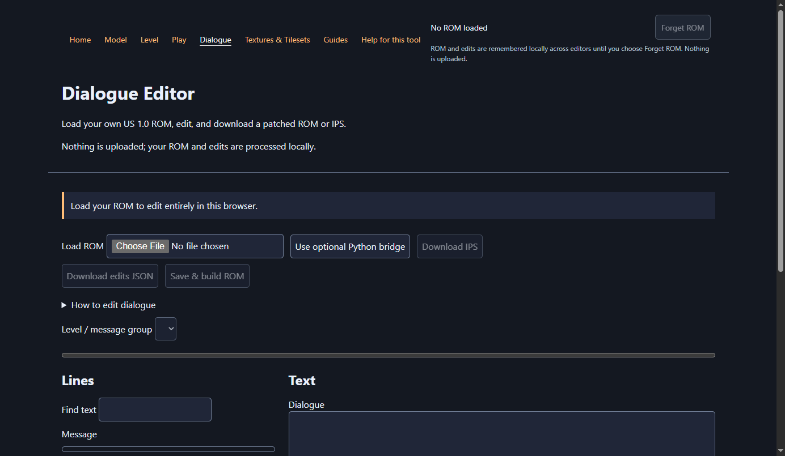

# Dialogue

[Open Dialogue](https://sssv-modkit-dev.github.io/sssv-modkit/dialogue.html) to edit messages and how long they stay on screen. This step is optional.

1. Use your shared US 1.0 ROM, or choose one with **Load ROM**.
2. Choose a level or message group, then select a line.
3. Edit the text and check the preview. Watch the space budget; shorten another line in the same group if needed.
4. Adjust the hold time where available. Check each occurrence: a line can appear more than once.
5. Choose **Download edits JSON** for a backup. Return with **Back to guided build** to include the changes at Review.

## Limits

Text must fit the existing space. The font preview approximates text colours. Timing has file round-trip checks only; check pacing in game. This is message editing, not camera or actor scripting.

The page's **Save & build ROM** combines dialogue and painted ground sheets. Use the guided build to include Models and Levels too. Nothing is uploaded.

## Advanced

Open **Advanced: text codes and limits** in the editor for supported codes and byte accounting. The optional Python bridge is for developer workflows; browser editing needs no bridge.

[All guides](../README.md) · [Getting started](GETTING-STARTED.md) · [Next: Play](PLAY.md)
