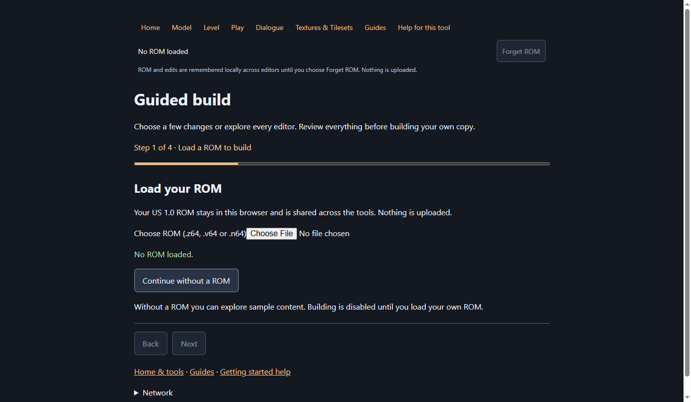

# Getting started

Use [Guided build](https://sssv-modkit-dev.github.io/sssv-modkit/start.html) to combine edits without installing tools.

1. Choose your own unzipped US 1.0 ROM. A remembered ROM loads automatically. You can explore sample content without one, but cannot build.
2. Choose **Mod in depth** to visit the editors. **Patch only** excludes saved editor changes; all nine listed patches are currently unavailable, so it produces an unchanged copy.
3. Visit [Models](MODEL-EDITOR.md), [Textures & Tilesets](TEXTURES-TILESETS.md), [Levels](LEVEL-EDITOR.md), then optional [Dialogue](DIALOGUE.md). Use **Back to guided build** after each editor, or skip a step.
4. At Review, check the saved changes and choose **Build ROM**. Download the IPS patch or ROM. Your source stays unchanged.
5. Choose **Play this build**, then **Play**. Follow the [Play guide](PLAY.md) to test and save the result.

## Limits

Edits are remembered in this browser with the source ROM. Download backups before clearing browser storage or choosing **Forget ROM**, which clears the source and saved changes. Conflicting edits, a different source ROM or unsupported changes can stop a build. Browser previews and a successful build do not prove that a stage works in game.

Nothing is uploaded: your ROM is read on your own device and never sent anywhere. See [Network](../NETWORK.md) for runtime downloads. Phones have touch controls; build speed and emulation performance depend on the device.

## Advanced

For Python builds and patch application, see [Command-line builds](CLI-BUILDS.md).

[All guides](../README.md) · [Next: Models](MODEL-EDITOR.md)
