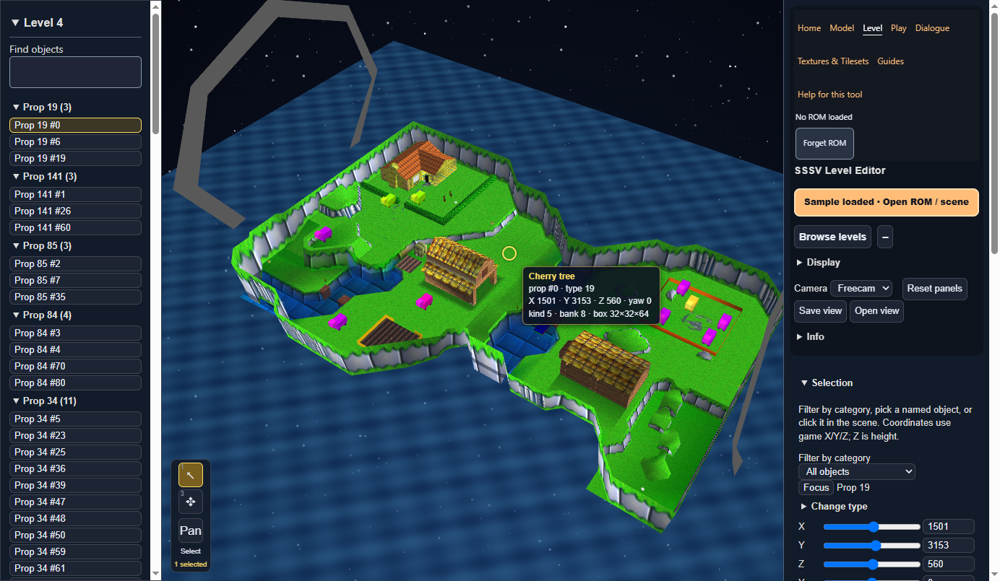

# Levels

[Open Level Editor](https://sssv-modkit-dev.github.io/sssv-modkit/level-editor.html) to move and add stage objects.

1. Choose **Start here: Open ROM / scene** and open your ROM, or use the shared ROM. Choose a level with **Browse levels**.
2. Right-drag to look around. Use WASD to travel and Q/E to change height. Freecam is the default; touch camera controls are available on phones.
3. Click an object, or drag empty space to select a group. Choose Move or edit the position fields. Changes apply live; Undo reverses them.
4. Use **Add objects** and **Place objects** to place a prop. Use **Change type** to replace a selected object's type.
5. Choose **Save level edits** for a backup. **Open level edits** needs the same source ROM.
6. Return with **Back to guided build**, or choose **Build & Play** to send a project to Play.

## Limits

Ground geometry is read-only; paint its pixels in [Textures & Tilesets](TEXTURES-TILESETS.md). Original objects cannot be deleted because scripts refer to them. Appended objects can be deleted, but are not connected to switches or goals. Added animals require an advanced build option and game testing. Portal destinations need extra runtime support.

Previews use static models where supported and approximations elsewhere. Check collision, progression and appearance in game. Saved view files store camera settings, not object edits.

## Advanced

The [level reference](../LEVEL-REFERENCE.md) covers source checks, project attachments and command-line build options.

[All guides](../README.md) · [Getting started](GETTING-STARTED.md) · [Next: Dialogue](DIALOGUE.md)
