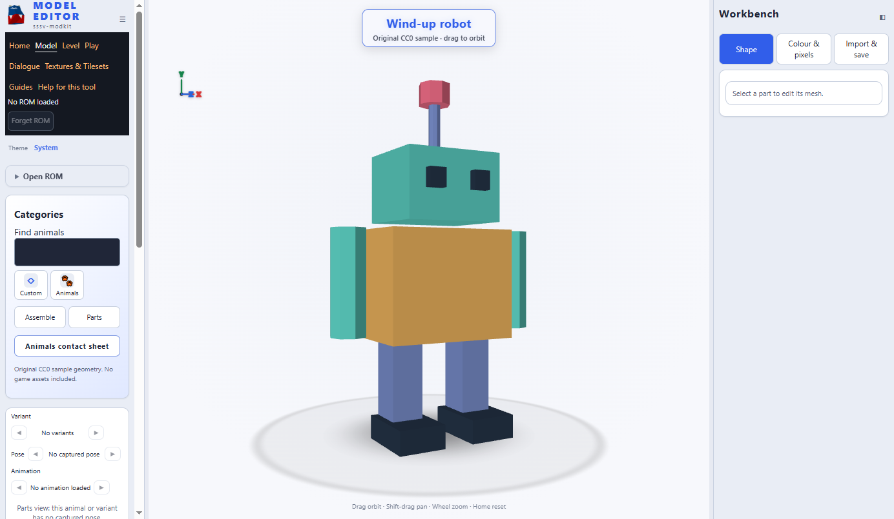

# Models

[Open Model Editor](https://sssv-modkit-dev.github.io/sssv-modkit/model-editor.html) to recolour and reshape parts, or paint supported eye textures.

1. Open the shared ROM, or explore the bundled sample models without one.
2. Pick an animal, then click a part. Shift/Ctrl-click selects several parts.
3. In **Shape**, change position or scale. Use Deform for bend, twist, taper or inflate. Undo reverses an edit.
4. In **Colour & pixels**, recolour parts or paint supported eye textures. Shared images or colours can affect other animals.
5. In **Import & save**, choose **Save edits** for a backup. **Open edits** restores a saved file with its matching source ROM.
6. Use **Back to guided build** to continue. Outside the guided path, **Build & Play** sends the edits to Play.

## Limits

Sample presets are previews, not ROM patches. Existing geometry keeps the same number of vertices and triangles. New rigs and arbitrary replacement models are not supported by the ROM writer. Eye painting edits the first supported frame only. Check shading and shape in game.

Static poses support 23 species. Camel, elephant, polar bear and rat have partial captures. Other animals and variants can have approximate previews. These are still poses, not animation.

## Advanced

See the [model reference](../MODEL-REFERENCE.md) for controls, shared colours and texture limits; use [configs](CONFIGS.md) for command-line edits.

Custom model import in **Import & save** previews and exports a separate package. That package cannot be built into a ROM.

[All guides](../README.md) · [Getting started](GETTING-STARTED.md) · [Next: Textures & Tilesets](TEXTURES-TILESETS.md)
