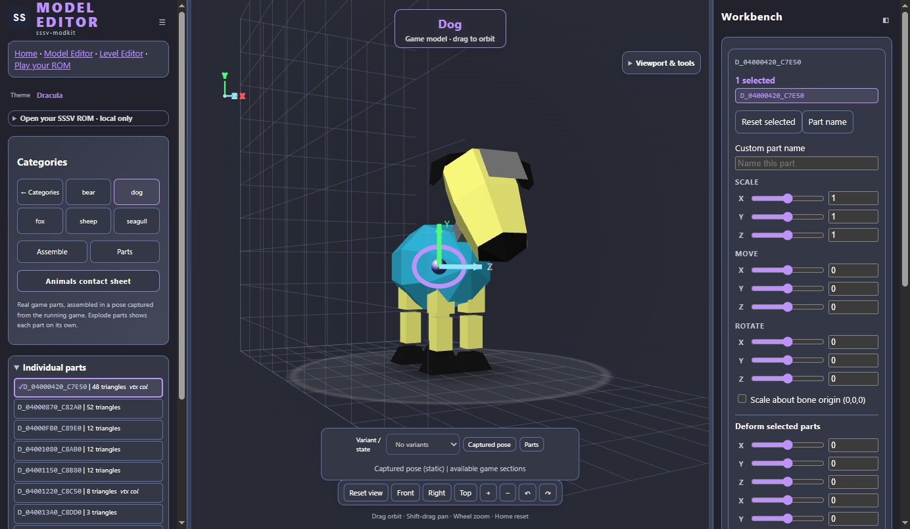

# Model Editor

[Open Model Editor](https://sssv-modkit-dev.github.io/sssv-modkit/model-editor.html)

Preview animal parts, experiment with their colours and shapes, and save edits
for a ROM build. The public demo includes five bundled animals with captured
poses and three original creatures; you can explore it without supplying a ROM.

## Try an edit

1. Pick a creature and a part.
2. Change its colour, scale or position, or try the deform controls.
3. Choose **Save edits** to download one project containing all changed animals
   and original models. Unchanged models are excluded.
4. Choose **Open edits** to load that project again. Legacy single-model files
   still open; source animal edits need the matching ROM loaded first.

Saved edits describe changes; they do not contain a game or a playable ROM.
Open your US 1.0 ROM directly: the page derives its animal table locally using
the bundled Python runtime. `.z64`, `.v64` and `.n64` byte orders are supported;
an existing animal table is an optional advanced input. Nothing is uploaded.
Bundled demo presets are not ROM patches. Use **Build & Play** to pass all game edits and the loaded ROM to
the browser builder and build a playable ROM or IPS patch. You can also [build a local viewer](VIEWER.md)
and follow the [config guide](CONFIGS.md) and [build instructions](GETTING-STARTED.md).

## Available tools

- Categories, variants, contact sheets and parts sheets.
- Shift/Ctrl-click or enable Multi-select to transform several parts together;
  click empty space to clear selection. Hover highlights parts and gizmo handles.
- Draggable part-name window with a close button, and a world-space reference grid.
- Undo/Redo buttons and Ctrl+Z/Ctrl+Y (Cmd+Z/Shift+Cmd+Z on Mac). A drag or
  brush stroke is one undo step; typing in text fields keeps native undo.
- Transform sliders have numeric fields: type a value or focus one and scroll
  to increment it. Bend, twist, taper and inflate are available under Deform.
- The bottom state picker shows available sections/variants and captured static
  poses. It does not synthesize the game's procedural animations.
- Returning to demos retains your source animals and edits; use Return to loaded
  animals in Categories to get back without selecting the ROM again.
- Recolouring, scale, position and individual vertex edits.
- Taper, bend, twist and inflate previews.
- Config import/export, themes and local ROM storage.
- Bundled animal assembly and pose-transform import; poses for other animals need their own checks.

## Eye textures

The Texture Workbench decodes supported 16-by-16 CI4 eye materials from your ROM.
Choose a palette swatch to paint individual pixels, recolour a swatch, or change
its opacity. Colours are quantized to the game's five-bit channels. The first
eye-animation frame is editable; other frames and unverified torso materials
are not exposed as paintable textures yet.

Eye images and palettes can be shared between animals. Editing one changes all
users of those bytes. Save edits includes the changed texture bytes with their
expected original values; Build & Play sends them through the protected builder.
Reset this texture restores its image and palette, while the main Reset restores
the current animal's supported textures and geometry. The original ROM stays intact.

The image editor includes pencil, bucket, eraser, rectangle selection and local
copy/cut/paste. Selection restricts painting and filling. Eraser and cut need a
transparent swatch; if none exists, explicitly make a palette entry transparent
first. Paste is clipped to the image and maps colours into the destination palette.

## Per-part colours

Choose **Selected parts** in Palette Workbench to change only their primitive
colour commands. Whole-animal colours remain available; selected-part overrides
use expected original words and the same builder safeguards. Shared commands
still affect every user. A sheep leg drawn four times from one part cannot have
four independent colours without separate material or mesh references. Parts
that inherit their colour need further material decoding before such overrides.

Existing geometry edits preserve vertex and triangle counts. Importing entirely
new models or rigs is not implemented. Preview appearance still needs checking
in the game, particularly deformation coverage and shading.

The site also includes a [Level Editor](LEVEL-EDITOR.md) and experimental
[browser play](https://sssv-modkit-dev.github.io/sssv-modkit/play.html).
Game compatibility and performance still need direct testing.

[Viewer reference](VIEWER.md) · [Back to the project](../../README.md)

## Model browser and actions

Choose a category under **MODEL**, then an animal. **Custom** contains the three original demos with cached head previews. **Demo** opens the original collection. Each model retains mesh, deformation and palette edits in memory until the page closes; export edits to keep them across sessions.

**Parts** spreads parts radially around the model origin. **Stretch**, **Bend** and **Twist** affect the highlighted part, or choose a random part when none is selected. **Random Palette** recolours the whole model, including a tint for surfaces without a prim colour. Texture sampling is not implemented; these surfaces remain vertex-colour approximations. Click a part to keep its highlight visible. The individual parts list opens mesh editing, with its own Reset button.

**Animals contact sheet** is a separate browsing view. Viewport tools float over the scene; **Reset view** restores the camera. **Save PNG image** downloads a transparent image. Phone layouts follow viewport size and orientation; portrait places scrollable controls in the bottom area.

The local animal-table input remains required. A ROM-only JavaScript implementation is estimated at 250–400 lines (roughly 12–20 KB), including the 170-line Python MIPS tracer/metadata path and equivalent display-list completeness validation. It needs parity coverage before replacing the input.
