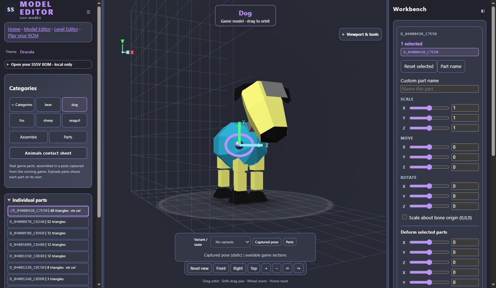

# Model Editor

[Open Model Editor](https://sssv-modkit-dev.github.io/sssv-modkit/parts_lab.html)

Preview animal parts, experiment with their colours and shapes, and save edits
for a ROM build. The public demo includes five bundled animals with captured
poses and three original creatures; you can explore it without supplying a ROM.

## Try an edit

1. Pick a creature and a part.
2. Change its colour, scale or position, or try the deform controls.
3. Choose **Save edits** to download the JSON config.
4. Choose **Open edits** to load that config again.

Saved edits describe changes; they do not contain a game or a playable ROM.
For ROM builds, open your animal table and ROM first; bundled demo presets are
not ROM patches. Use **Build & Play** to pass game edits and the loaded ROM to
the browser builder and build a playable ROM or IPS patch. You can also [build a local viewer](VIEWER.md)
and follow the [config guide](CONFIGS.md) and [build instructions](GETTING-STARTED.md).

## Available tools

- Part selection, variants, galleries and parts sheets.
- Recolouring, scale, position and individual vertex edits.
- Taper, bend, twist and inflate previews.
- Config import/export, themes and local ROM storage.
- Bundled animal assembly and pose-transform import; poses for other animals need their own checks.

Existing geometry edits preserve vertex and triangle counts. Importing entirely
new models or rigs is not implemented. Preview appearance still needs checking
in the game, particularly deformation coverage and shading.

The site also includes a [level editor](LEVEL-EDITOR.md) and experimental
[browser play](https://sssv-modkit-dev.github.io/sssv-modkit/play.html).
Game compatibility and performance still need direct testing.

[Viewer reference](VIEWER.md) · [Back to the project](../../README.md)
