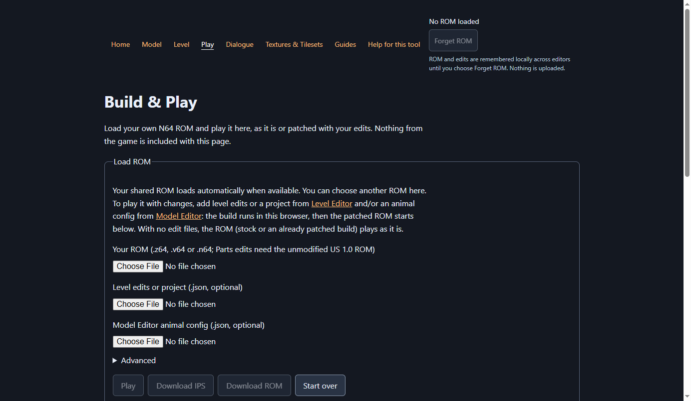

# Play

[Open Play](https://sssv-modkit-dev.github.io/sssv-modkit/play.html) to run your own ROM or build one with saved edit files.

1. From the guided build, choose **Play this build**. Otherwise choose a ROM in Play; a shared ROM loads automatically when available.
2. For a manual build, add optional level edits or a project and a model config. With no edit files, Play runs the selected ROM as it is.
3. Press **Play** or **Build & Play**, as shown. Wait for the build and emulator to load.
4. Click inside the game to focus it. Use the emulator's controller settings for keys, gamepads and touch controls.
5. Test the edited parts and stages. Use **Download IPS** to save a patch or **Download ROM** for your own use. Share patches rather than ROMs.

## Limits

Browser emulation is experimental. WebGL, device performance and emulator compatibility affect results. A successful build does not prove collision, progression, timing or appearance. Start a new game session when checking newly built geometry; an older save state can hold old data.

For all remembered editor changes, use the guided build's Review step. The manual Play form builds from the files attached there. Your ROM and edits stay on this device. Runtime files download from this site; see [Network](../NETWORK.md).

## Advanced

Play's **Advanced** panel lets you change emulator, allow added animals or relocate an oversized level-only build. These options need separate game testing. Relocation cannot be combined with model edits.

[All guides](../README.md) · [Getting started](GETTING-STARTED.md)
