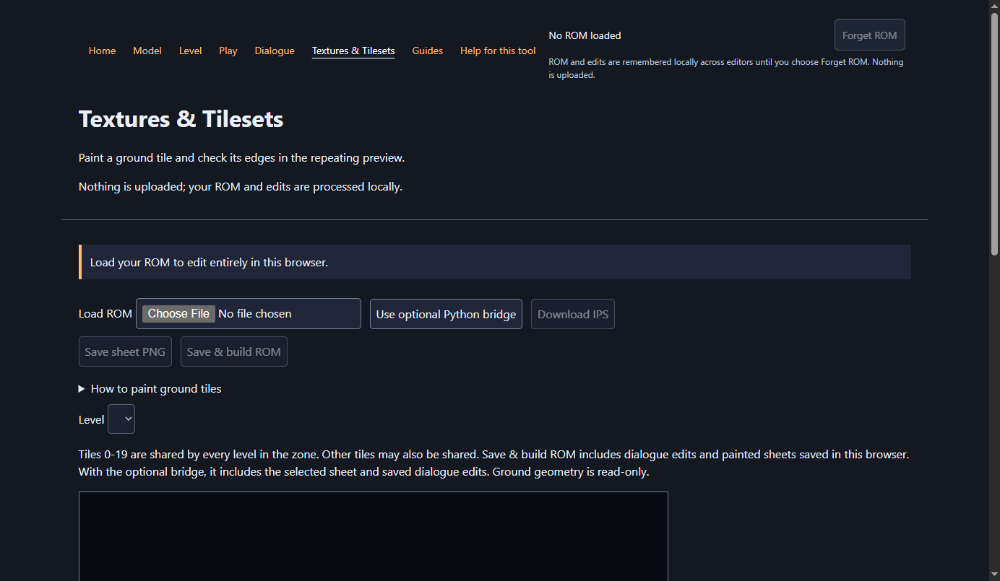

# Textures & Tilesets

[Open Textures & Tilesets](https://sssv-modkit-dev.github.io/sssv-modkit/textures.html) to paint ground tiles and check how their edges repeat.

1. Use your shared US 1.0 ROM, or choose one with **Load ROM**.
2. Choose a level, then click a tile in the sheet.
3. Pick a brush colour and paint on the enlarged tile. **Pick colour** samples a pixel. **Undo stroke** reverses a stroke.
4. Check the repeating preview for seams. Use **Save sheet PNG** for a backup of the selected sheet.
5. Return with **Back to guided build** to combine these changes with the other editors at Review.

## Limits

Tiles 0–19 are shared across a zone. Other tiles can also be shared. Check affected levels in game. This tool paints pixels; ground geometry is read-only.

Edits are remembered with the source ROM in this browser. The page's **Save & build ROM** includes saved dialogue and painted sheets. Use the guided build to include model and level changes too. Nothing is uploaded.

## Advanced

Old terrain.html links redirect here. The optional Python bridge includes only the selected sheet and saved dialogue in its build.

[All guides](../README.md) · [Getting started](GETTING-STARTED.md) · [Next: Levels](LEVEL-EDITOR.md)
